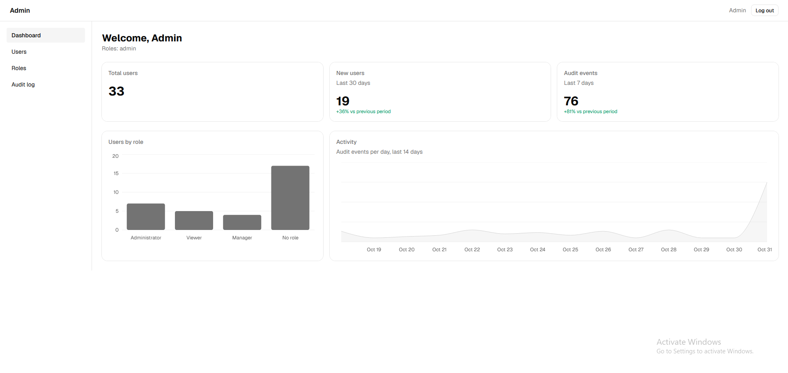
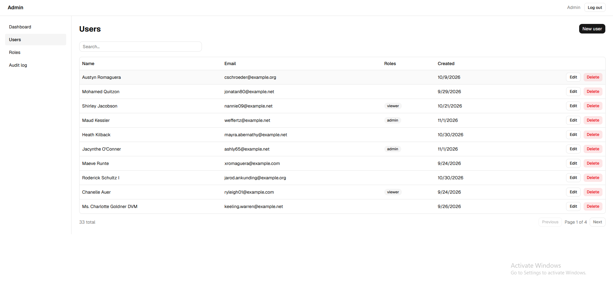
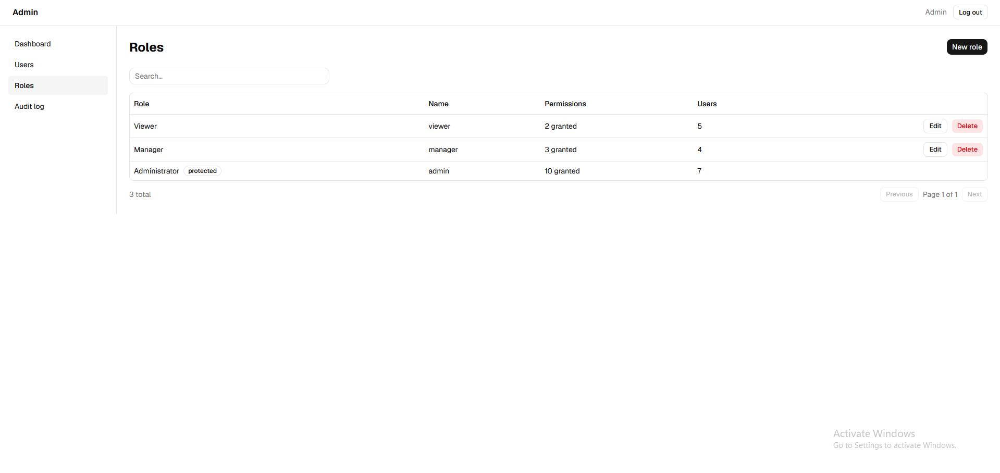
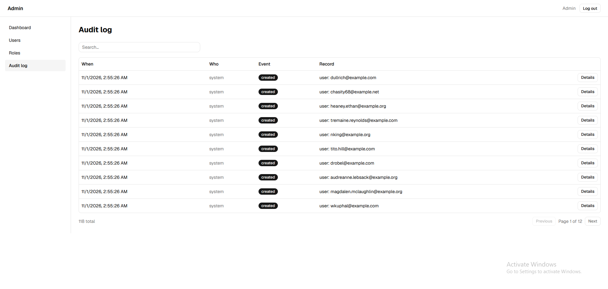

# admin-starter


A reusable admin-dashboard starter kit: a Laravel REST API with Sanctum cookie auth, and a React SPA
(Vite, Tailwind, shadcn/ui). Built as infrastructure: **every pattern is generic**, so a new project
is a fork (or "Use this template") away.



## Features
- **Auth:** Sanctum SPA flow (CSRF + session cookie), route guards, expired-session handling
- **RBAC:** roles ↔ permissions (normalized), wired into Laravel's Gate (`can:users.update`), permission-aware UI
- **Generic CRUD API:** one `ResourceController` + `Filterable`/`Sortable` traits give any model pagination,
  sorting, filtering and search from a few whitelist methods
- **Generic UI:** `DataTable`, `ResourceForm`, `ConfirmDialog` and `CrudPage` build a full admin page from ~30 lines of config
- **Audit log:** append-only, before/after diffs via an `Auditable` trait; pivot changes (role assignment) included
- **Dashboard:** widgets driven by a metrics registry (stat / trend / distribution), each gated by permission
- **Quality:** feature tests on MySQL in CI, Pint, ESLint, production-cache check

| Users | Role editor | Audit log |
|---|---|---|
|  |  |  |

## Stack
**api/** Laravel, Breeze (API stack), Sanctum, MySQL · **web/** React (Vite), Tailwind CSS, shadcn/ui,
TanStack Query, react-router-dom, axios

## Quick start
Prerequisites: PHP, Composer, MySQL, Node 20.19+ (or 22.12+).

```bash
# API  ->  http://localhost:8000
cd api
cp .env.example .env          # set DB_PASSWORD (create the admin_starter database first)
composer install
php artisan key:generate
php artisan migrate --seed    # roles, permissions, demo users (local only)
php artisan serve

# Web  ->  http://localhost:5173
cd web
cp .env.example .env
npm install
npm run dev
```
Use `localhost` (not `127.0.0.1`) on both sides so session cookies work. Optional:
`docker compose up -d` for MySQL, and `php artisan db:seed --class=DemoDataSeeder` for sample data.

## Demo accounts (local only, password `password`)
| Email | Role | Can |
|---|---|---|
| admin@example.com | admin | everything |
| manager@example.com | manager | view, create and edit users (not delete, not assign roles) |
| viewer@example.com | viewer | read-only |

## Documentation
- [API conventions and "add a new resource" recipe](docs/api-conventions.md)
- [Database schema](docs/er-diagram.md)
- [Architecture decisions](docs/adr/)
- [Deployment guide](docs/deployment.md)

## Tests
```bash
cd api && php artisan test     # backend
cd web && npm run lint && npm run build
```

## License
MIT