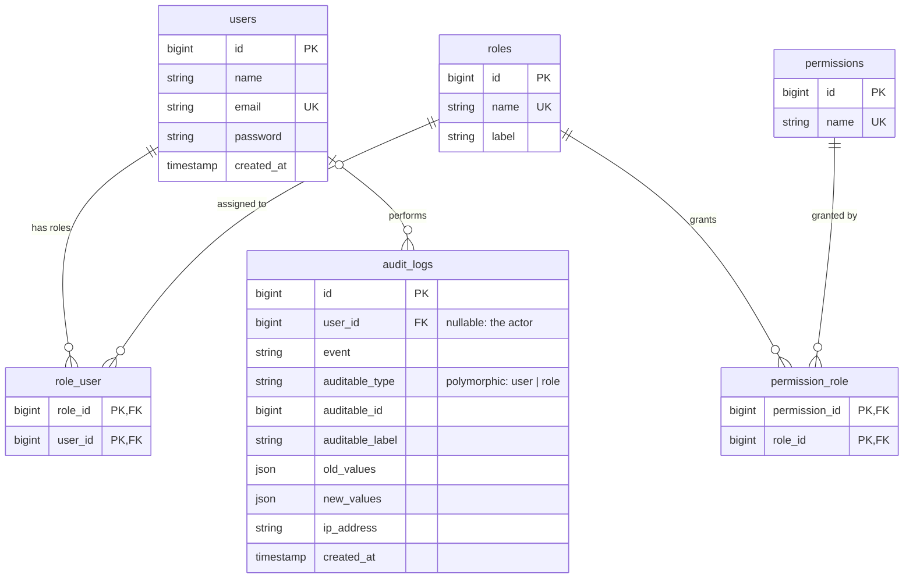

# Database schema

Notes: `audit_logs.auditable_*` points at a `users` or `roles` row (polymorphic, so it has no foreign key).
Framework tables (`sessions`, `cache`, `jobs`, `migrations`) are omitted.